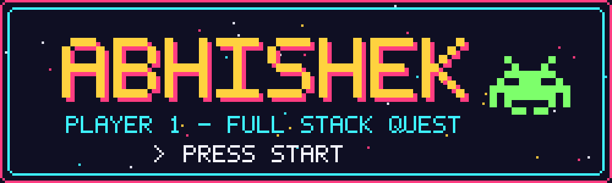
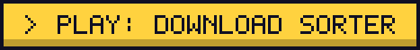
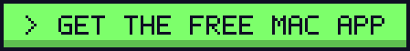
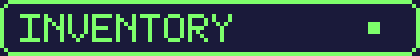

<div align="center">
  
</div>

<br>

<div align="center">
  
</div>

```text
PLAYER ........ Abhishek (@Abhi97shek)
CLASS ......... Full Stack Engineer (in training)
LEARNING ...... React Native
STATUS ........ Online - open to collaborate
```

<div align="center">
  
</div>

```text
[x] QUEST 1 : Download Sorter - a free Mac app that tidies your Downloads folder
[ ] QUEST 2 : Ship a React Native app
[ ] QUEST 3 : ??? (loading...)
```

<div align="center">
  <a href="https://github.com/Abhi97shek/download-sorter"></a>
  &nbsp;
  <a href="https://github.com/Abhi97shek/download-sorter/releases/latest"></a>
</div>

<br>

<div align="center">
  
  <br><br>
  
  
  
  
  
  
</div>

<br>

<div align="center">
  
  <br><br>
  📫 <a href="mailto:abhi.kumar736@gmail.com">abhi.kumar736@gmail.com</a>
  <br><br>
  
</div>
